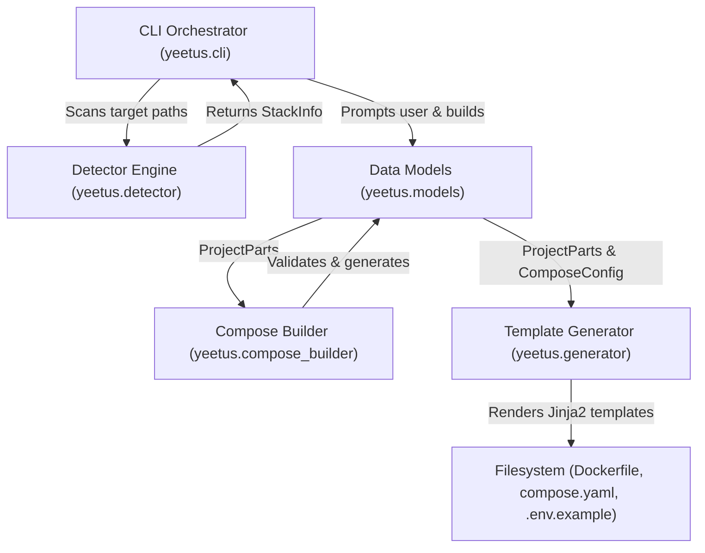
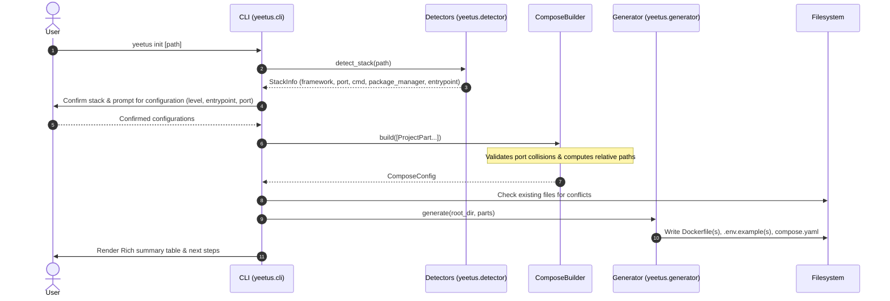
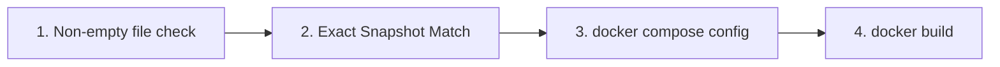

# Yeetus — Architecture & System Design

> This document details the architectural principles, data flow, subsystem components, template engine, and verification pipeline of Yeetus.

---

## 1. Design Philosophy

Yeetus was engineered around several foundational principles:

1. **Standalone Engine First**: Freedom from proprietary Docker Desktop dependencies, tailored specifically for developers running vanilla Docker Engine on Linux.
2. **Unified Compose Pipeline (No Post-Merge Hacks)**: Instead of generating individual `docker-compose.yaml` fragments and attempting to merge text/YAML post-hoc, Yeetus constructs a single, strongly-typed `ComposeConfig` model in memory. This eliminates merge anomalies and enables centralized validation (e.g. port collision detection and cross-service dependencies).
3. **Strict Separation of Concerns**:
   - **Detection** is decoupled from generation.
   - **Models** are purely declarative and framework-agnostic.
   - **Templates** contain container layout logic without CLI side-effects.
   - **CLI** manages user interaction and orchestration only.
4. **Test-Driven Rigor (TDD)**: Every stack and boilerplate permutation is locked down with snapshot fixtures and multi-stage verification (`file check -> snapshot diff -> docker compose config -> docker build`).

---

## 2. High-Level Architecture & Workflow



### Execution Lifecycle



---

## 3. Subsystem Breakdown

### 3.1 Data Models (`yeetus.models`)

The core models provide the clean contract passed between detectors, builder, generator, and CLI:

- **`StackInfo`**: Represents detected runtime characteristics:
  - `stack_type`: High-level family (`python`, `node`, `static`).
  - `framework`: Specific framework (`flask`, `fastapi`, `django`, `nextjs`, `react`, `vite`, `vue`, `static`).
  - `port`: Default container port.
  - `cmd`: Execution command array/string.
  - `package_manager`: Package manager (`npm`, `pnpm`, `yarn`, `bun`).
  - `entrypoint`: Primary entry file (e.g. `app.py`, `main.py`, `manage.py`).
  - `with_entrypoint(entrypoint)` & `with_package_manager(package_manager)`: Immutable transition helpers that reconfigure `cmd` and `.env.example`.
- **`ProjectPart`**: Represents a discrete service or subproject directory:
  - `name`: Service identifier (e.g. `web`, `api`, `frontend`).
  - `path`: Absolute filesystem path.
  - `stack_info`: Bound `StackInfo`.
  - `level`: Boilerplate level (`minimal` or `full`).
  - `depends_on`: Inter-service dependencies.
  - `port` / `target_port`: Port mappings.
- **`ComposeConfig` & `ComposeServiceConfig`**: Representation of the unified Docker Compose schema ready for Jinja2 rendering.

---

### 3.2 Detection Engine (`yeetus.detector`)

Detectors follow a shared interface (`BaseDetector`) and inspect marker files, dependency declarations, and project structures:

1. **Python Detector (`yeetus.detector.python`)**:
   - Markers inspected: `requirements.txt`, `pyproject.toml`, `uv.lock`, `Pipfile`, `setup.py`, `manage.py`.
   - Framework detection via regex matching on dependencies:
     - FastAPI: `fastapi`
     - Flask: `flask`
     - Django: `django` or presence of `manage.py`
     - Generic Python fallback
   - Entrypoint detection: Defaults to `main.py` (FastAPI), `manage.py` (Django), or `app.py` (Flask/Generic).
2. **Node.js Detector (`yeetus.detector.node`)**:
   - Inspects `package.json` dependencies and devDependencies:
     - Next.js: `next`
     - Vite: `vite`
     - Vue: `vue`
     - React: `react`
     - Generic Node fallback
   - **Package Manager Detection (`detect_package_manager`)**:
     - Explicit declaration in `package.json`: `"packageManager": "pnpm@..."`
     - Configuration & lockfiles:
       - **bun**: `bun.lockb`, `bun.lock`, `bunfig.toml`
       - **pnpm**: `pnpm-lock.yaml`, `pnpm-workspace.yaml`, `.pnpmfile.cjs`
       - **yarn**: `yarn.lock`, `.yarnrc.yml`, `.yarnrc`
       - **npm**: `package-lock.json`, `npm-shrinkwrap.json`, `.npmrc`
       - Default: `npm`
3. **Static HTML Detector (`yeetus.detector.static`)**:
   - Identifies static web applications by the presence of `index.html` without a `package.json`. Configures an Nginx Alpine container on port `80`.

---

### 3.3 Compose Builder (`yeetus.compose_builder`)

The `ComposeBuilder` translates a collection of `ProjectPart` instances into a unified `ComposeConfig`:
- **Context Normalization**: Calculates the build context relative to the root compose directory. If a part resides in a subdirectory `backend/`, its context is cleanly set to `backend`.
- **Port Collision Guard (`PortCollisionError`)**: Validates that no two services bind to the same host port. If a collision is detected (e.g. two services requesting port `8080`), an explicit `PortCollisionError` is raised before any files are written.
- **Inter-Service Wiring**: Resolves `depends_on` relationships between services so that dependent services start in the proper order.
- **Environment File Association**: Automatically links `.env` configuration files for services configured with `full` boilerplate.

---

### 3.4 Template Generator (`yeetus.generator`)

The template system is powered by Jinja2 with whitespace trimming (`trim_blocks=True`, `lstrip_blocks=True`).

#### Template Directory Layout
```
yeetus/templates/
├── python/
│   ├── Dockerfile.minimal.j2
│   └── Dockerfile.full.j2
├── node/
│   ├── Dockerfile.minimal.j2
│   └── Dockerfile.full.j2
├── static/
│   ├── Dockerfile.minimal.j2
│   └── Dockerfile.full.j2
└── compose/
    └── compose.yaml.j2
```

#### Minimal vs. Full Boilerplate Matrix

| Feature | Minimal Level | Full Level |
|---|---|---|
| **Base Image** | Lightweight slim/alpine image | Lightweight slim/alpine image |
| **Dependencies** | Installed with application | Layer-cached (dependencies copied & installed first) |
| **Security** | Root user | Non-root unprivileged user (`appuser` / `node` / `nginx` / `bun`) |
| **Healthcheck** | None | Container `HEALTHCHECK` with zero-external-dependency curl/urllib/node/fetch probes |
| **Env Variables** | Base defaults | `.env.example` file generated with framework-specific keys |
| **Compose Restart**| None | `restart: unless-stopped` |

---

### 3.5 CLI Layer (`yeetus.cli`)

Built with `typer` and `rich`:
- **Interactive Prompts**: Prompts for stack confirmation, boilerplate level, service names, and Python entrypoint files.
- **Non-Interactive Overrides**: Supports automated execution through flags (`--level`, `--entrypoint`, `--multi`, `--force`, `--dry-run`, `--no-detection`).
- **Conflict Handling**: Scans target directories prior to generation; if target files already exist, prompts the user before overwriting unless `--force` is specified.
- **Dry-Run Mode**: Visualizes all files and types in a Rich preview table without performing filesystem modifications.

---

## 4. Verification & Testing Architecture

Yeetus enforces a 4-tier verification pipeline in `tests/test_generation.py`:



1. **File Existence & Integrity**: Ensures all generated files exist and contain non-zero byte counts.
2. **Snapshot Comparison**: Asserts character-for-character equivalence against golden snapshots in `tests/expected/` across all 16 test matrix combinations.
3. **Compose Validation**: Executes `docker compose config` on the generated `compose.yaml` to ensure schema compliance.
4. **Live Image Compilation**: Invokes `docker build` on the scaffolded project to verify that package manager installations, dependency commands, and Dockerfile instructions compile without errors.

---

## 5. Adding New Tech Stacks

Yeetus is designed to be easily extensible. To introduce a new technology stack (e.g. Go, Rust, Ruby):

1. **Define Stack In Models (`yeetus/models.py`)**:
   Add new framework identifiers to `StackInfo`.
2. **Create Detector (`yeetus/detector/<stack>.py`)**:
   Implement `BaseDetector.detect(path: Path) -> StackInfo | None` searching for stack-specific markers (`go.mod`, `Cargo.toml`, `Gemfile`).
3. **Register Detector (`yeetus/detector/__init__.py`)**:
   Add the new detector to the `DETECTORS` list.
4. **Create Templates (`yeetus/templates/<stack>/`)**:
   Create `Dockerfile.minimal.j2` and `Dockerfile.full.j2`.
5. **Add Fixtures & Expected Snapshots**:
   Add dummy marker fixtures under `tests/fixtures/` and expected outputs under `tests/expected/`.
6. **Register in CLI Catalog (`yeetus/cli.py`)**:
   Add default framework entries to `FRAMEWORK_CATALOG`.
